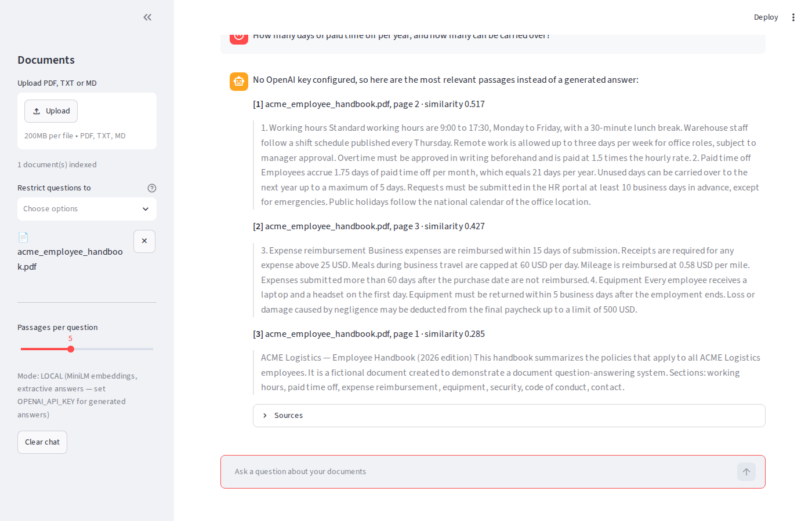

# Document Q&A — RAG knowledge base with a chat interface

Upload PDFs (or TXT/Markdown), ask questions, get answers **with citations to the
exact passages** they came from. Retrieval-Augmented Generation (RAG) with
OpenAI embeddings + chat models and a persistent ChromaDB vector store. No
framework lock-in: ~300 lines of plain Python you can read in one sitting.



## How it works

```
upload PDF ──> extract text per page ──> overlapping chunks (1000 chars, 150 overlap)
           ──> embeddings ──> ChromaDB (persistent, cosine similarity)

question   ──> embedding ──> top-k most similar chunks
           ──> LLM answers ONLY from those chunks, citing [1], [2]…
           ──> "I don't know" when the documents don't contain the answer
```

* **Embeddings:** OpenAI `text-embedding-3-small` (default) or a local
  all-MiniLM-L6-v2 model when no API key is present (no cost, runs offline).
* **Answers:** OpenAI `gpt-4o-mini` (default; any chat model via `CHAT_MODEL`).
  Without a key the app still works in *extractive* mode: it returns the most
  relevant passages instead of a generated answer.
* **Vector store:** ChromaDB on disk (`./chroma_db`). Re-uploading a file with
  the same name replaces its old chunks, so nothing stale is left behind.
* **Scope control:** restrict a question to one or more documents.
* **Citations:** every answer shows source file, page number and similarity score.
* **Conversation memory:** the last turns are passed to the model for follow-up questions.

## Quick start

```bash
pip install -r requirements.txt
cp .env.example .env            # add your OPENAI_API_KEY (optional for testing)

streamlit run app.py            # chat interface at http://localhost:8501
```

Command line (same engine, useful for batch indexing or scripting):

```bash
python cli.py ingest sample/                       # index a folder or files
python cli.py ask "What is the daily meal cap?"    # answer with sources
python cli.py ask "..." --source contract.pdf      # restrict to one document
python cli.py list                                 # indexed documents
python cli.py reset                                # clear the index
```

Windows (PowerShell): the same commands work; use `copy .env.example .env`.

## Configuration (`.env`)

| Variable | Default | Meaning |
|---|---|---|
| `OPENAI_API_KEY` | — | Enables OpenAI embeddings and generated answers |
| `EMBEDDING_PROVIDER` | `openai` if key set, else `local` | `openai` or `local` |
| `EMBEDDING_MODEL` | `text-embedding-3-small` | OpenAI embedding model |
| `CHAT_MODEL` | `gpt-4o-mini` | OpenAI chat model |
| `CHROMA_DIR` | `./chroma_db` | Vector store location |
| `CHUNK_SIZE` / `CHUNK_OVERLAP` | `1000` / `150` | Chunking (characters) |
| `TOP_K` | `5` | Passages retrieved per question |

Changing the embedding model creates a separate collection automatically
(vectors from different models are not comparable).

## Project layout

```
app.py            Streamlit chat UI (upload, index, ask, sources, delete)
cli.py            command-line interface
rag/config.py     settings from environment
rag/ingest.py     text extraction (pypdf), chunking, indexing
rag/store.py      ChromaDB client + embedding functions (OpenAI / local)
rag/query.py      retrieval, prompt, answer generation, extractive fallback
sample/           a fictional employee handbook PDF to try it out
screenshots/      what the UI looks like
```

## Extending

* **Scanned PDFs:** run OCR first (e.g. `ocrmypdf`) — pages without a text layer are reported as skipped.
* **Other LLM providers:** `rag/query.py::answer_with_llm` is the only place that calls the model.
* **Pinecone / Qdrant / pgvector:** `rag/store.py` isolates the vector store; swap the client there.
* **Access control / multi-user:** add a `user` field to chunk metadata and filter in `retrieve()`.
* **API instead of UI:** wrap `ingest_files()` and `ask()` in FastAPI endpoints.

## Why no LangChain / LlamaIndex?

For a system this size they add more moving parts than they remove. Everything
here is explicit (how text is chunked, what the prompt says, what gets cited),
which makes it easier to debug and to hand over. Either framework can be
dropped in later if the project grows into agents or multi-step pipelines.
